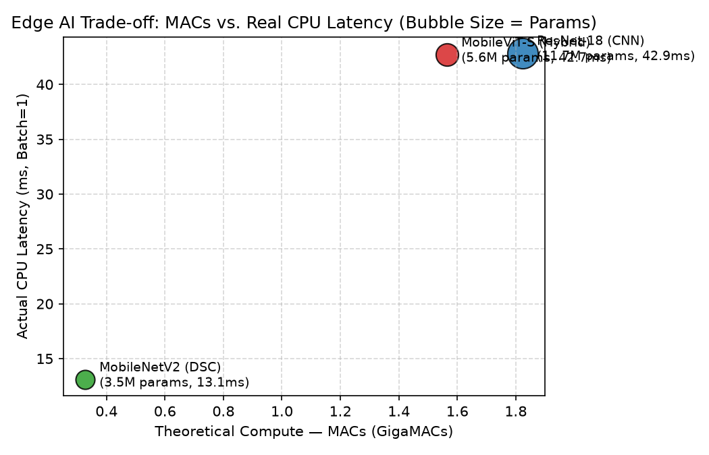
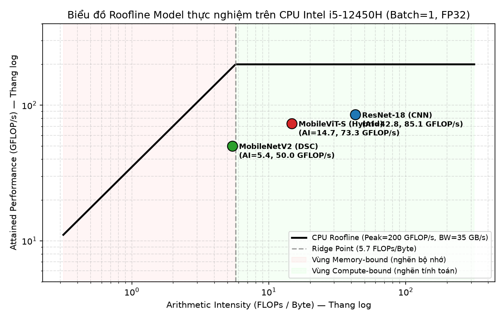
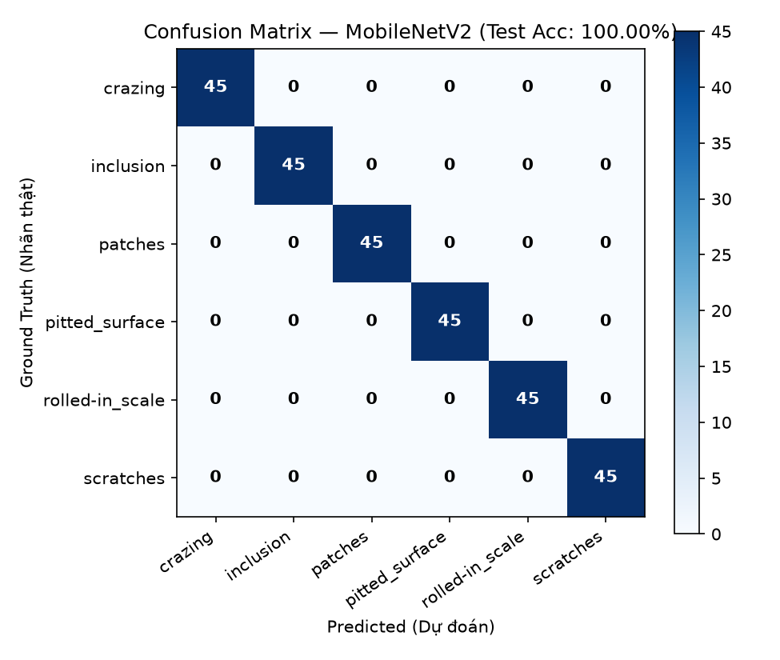
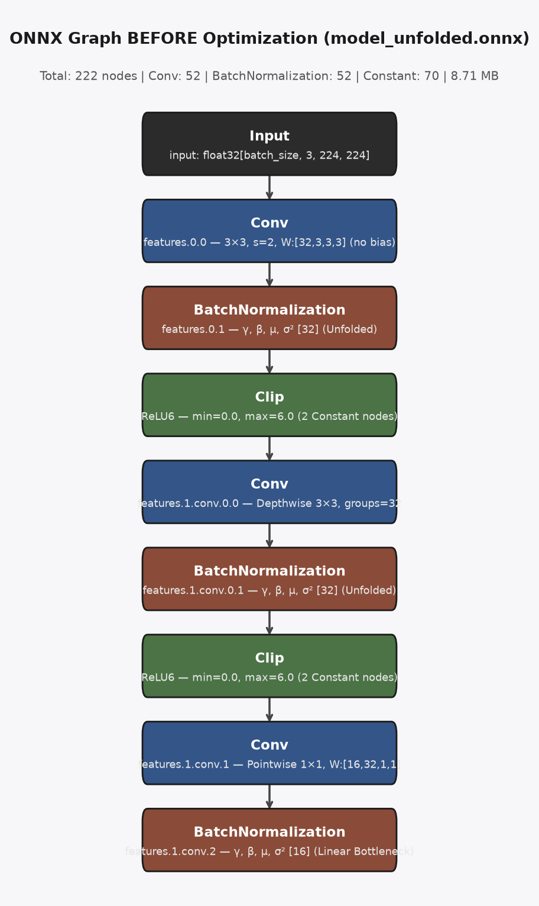
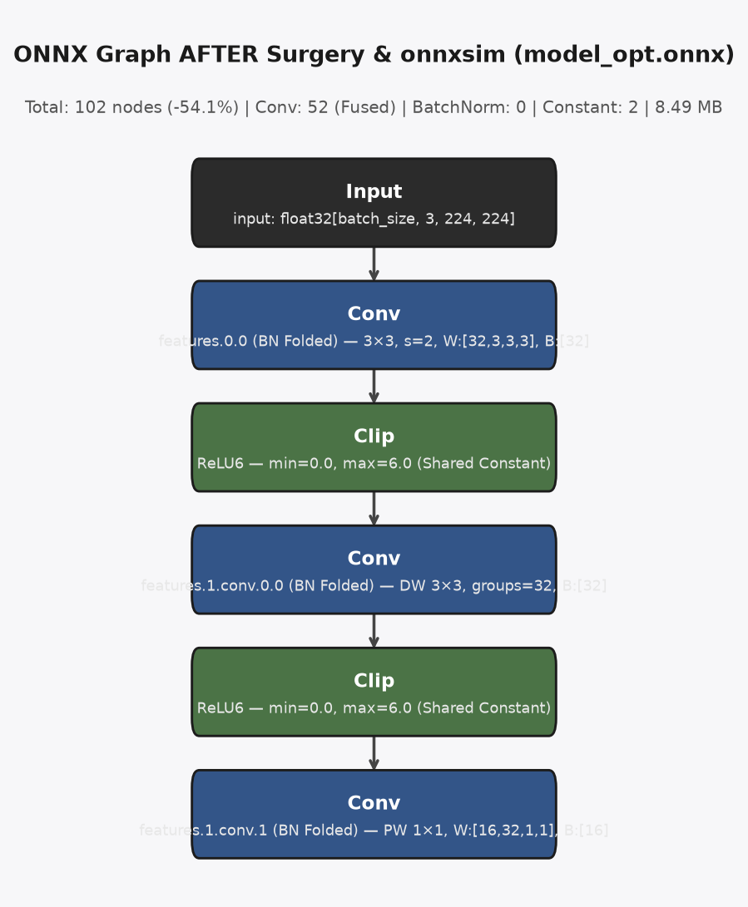
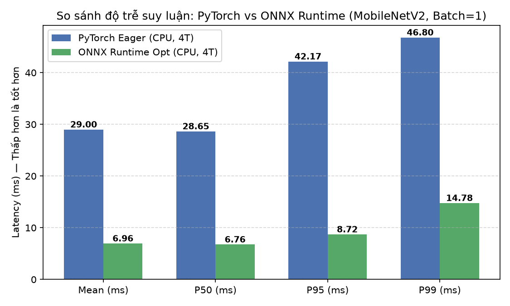

# Hệ thống phân loại khuyết tật bề mặt thép thời gian thực (NEU Surface Defect) tối ưu hóa bằng ONNX

Dự án xây dựng quy trình từ nghiên cứu kiến trúc mạng gọn nhẹ, phân tích chỉ số phần cứng biên theo mô hình **Roofline**, huấn luyện kiểm tra ngoại quan công nghiệp (**Industrial AOI**) đến **phẫu thuật đồ thị tính toán ONNX (`BatchNorm Folding` & `Constant Folding`)**, kiểm định sai số số học (`FP32 < 1e-5`) và đo độ trễ suy luận chuẩn sản xuất trên CPU.

---

## 1. Điểm nhấn kỹ thuật và kết quả thực nghiệm chính

- **Độ chính xác tuyệt đối trên tập kiểm thử độc lập:** Đạt **100.00% Test Accuracy** (270/270 ảnh, Stratified Split `70/15/15`, `seed=42`) trên 6 loại lỗi bề mặt thép (*Crazing, Inclusion, Patches, Pitted Surface, Rolled-in Scale, Scratches*).
- **Phẫu thuật đồ thị ONNX (Graph Surgery):** Gập toàn bộ **52 lớp `BatchNormalization`** trực tiếp vào trọng số của 52 lớp `Conv2d` đứng liền trước và loại bỏ **68 node `Constant` dư thừa**, giảm tổng số node của đồ thị từ **222 node xuống còn 102 node (-54.1%)** và giảm dung lượng mô hình xuống **8.49 MB**.
- **Kiểm định số học nghiêm ngặt (Numerical Validation):** Sai số xác suất Softmax cực đại giữa PyTorch gốc và ONNX Runtime trên toàn bộ tập Test chỉ ở mức **`4.83e-06` (`< 1e-5`)**, sai số trung bình **`6.75e-09`**, tỷ lệ đồng thuận dự đoán lớp đạt **100.00%**.
- **Tăng tốc suy luận thực tế trên CPU (Intel Core i5-12450H, `batch_size = 1`):**
  - **Đơn luồng (`1 thread`):** Giảm độ trễ từ `22.07 ms` (PyTorch) xuống **`9.78 ms`** (ONNX Runtime) — **tăng tốc 2.26x** (**102.3 FPS**).
  - **Đa luồng (`4 threads`):** Giảm độ trễ xuống **`4.07 – 4.71 ms`** (`P95 = 5.29 ms`) — **tăng tốc 5.64x** so với PyTorch Eager (**212.5 – 245.5 FPS**), nhanh gấp **3.8x** `ResNet-18` và **10.8x** `MobileViT-S`.

---

## 2. Phân tích kiến trúc gọn nhẹ và mô hình Roofline trên CPU

### 2.1. Kiểm chứng toán tử `Depthwise Separable Convolution` và `Inverted Residual`
So sánh trên cùng kích thước tensor đầu vào $(1, 32, 112, 112) \to (1, 64, 112, 112)$ với kernel $3 \times 3$:

| Toán tử | Params (Lý thuyết Conv) | Params (Đo bằng `thop`, gồm BN) | MACs (`thop`) | Tỷ lệ giảm MACs |
| :--- | :---: | :---: | :---: | :---: |
| **Standard Conv $3 \times 3$** | 18,432 | 18,624 | 234,422,272 | 1.00x (Baseline) |
| **Depthwise Separable Conv** | 2,336 | 2,528 | 34,119,680 | **6.87x** (Lý thuyết Conv: **7.89x**) |

> **Ghi chú kỹ thuật:** Tỷ lệ giảm MACs thực tế khi chưa tối ưu là `6.87x` thay vì `7.89x` lý thuyết vì `DepthwiseSeparableConv` phải đi qua **2 lớp `BatchNorm2d`** riêng biệt (Depthwise BN + Pointwise BN). Đây chính là động lực để thực hiện **BatchNorm Folding** ở giai đoạn tối ưu đồ thị ONNX nhằm triệt tiêu hoàn toàn chi phí truy xuất bộ nhớ của các lớp chuẩn hóa này.

### 2.2. Đối chiếu chỉ số phần cứng biên và phân tích Roofline (`ResNet-18` vs `MobileNetV2` vs `MobileViT-S`)

Đo thực nghiệm trên CPU **Intel Core i5-12450H** (`batch_size = 1`, `FP32`, đầu vào $1 \times 3 \times 224 \times 224$):

| Mô hình | Kiến trúc | Params (M) | MACs (G) | Peak Activation RAM (MB) | Lưu lượng RAM ước tính (MB) | Arithmetic Intensity (FLOPs/Byte) | Hiệu năng đạt được (GFLOP/s) |
| :--- | :--- | :---: | :---: | :---: | :---: | :---: | :---: |
| **ResNet-18** | CNN truyền thống | 11.69 | 1.824 | **18.99** | 81.3 | **42.77** | **85.12** |
| **MobileNetV2** | Inverted Residual (DSC) | **3.50** | **0.327** | 47.86 | 115.6 | 5.40 | 50.03 |
| **MobileViT-S** | Hybrid CNN-Transformer | 5.58 | 1.566 | 88.10 | 203.0 | 14.71 | 73.31 |





**Ba kết luận quan trọng từ mô hình Roofline:**
1. **Nghịch lý FLOPs vs. Latency (`MobileViT-S` vs `ResNet-18`):** Dù `MobileViT-S` có số lượng tham số ít hơn một nửa (`5.58M` so với `11.69M`) và ít MACs hơn (`1.566G` so với `1.824G`), độ trễ thực tế lại ngang bằng hoặc chậm hơn nhiều so với `ResNet-18` do các phép biến đổi `Unfold/Fold`, `Permute` và `Multi-Head Self-Attention` phát sinh tới `203.0 MB` lưu lượng đọc/ghi bộ nhớ và đỉnh RAM lên tới `88.10 MB`.
2. **Đặc tính Memory-bound của `MobileNetV2`:** Với `Arithmetic Intensity = 5.40 FLOPs/Byte` (nằm bên trái điểm gãy Ridge Point), `MobileNetV2` bị giới hạn bởi băng thông bộ nhớ RAM do các lớp `Depthwise Conv` và `BatchNorm` có mật độ tính toán trên mỗi byte thấp.
3. **Đỉnh bộ nhớ kích hoạt (Peak Activation Footprint):** `MobileNetV2` tiêu thụ `47.86 MB` Peak RAM (cao hơn `18.99 MB` của `ResNet-18`) vì bước mở rộng kênh `expand_ratio = 6` trong khối Inverted Residual tạo ra các tensor trung gian kích thước lớn ở những tầng đầu.

---

## 3. Huấn luyện và đánh giá kiểm tra ngoại quan (NEU Surface Defect)

- **Phân chia dữ liệu chống rò rỉ (Zero Data Leakage):** Toàn bộ 1.800 ảnh (`200×200`, 6 lớp × 300 ảnh/lớp) được chia phân tầng cố định (`seed=42`) thành **1.260 ảnh Train (70%)**, **270 ảnh Validation (15%)** và **270 ảnh Test (15%)**.
- **Huấn luyện (`NVIDIA GeForce RTX 4050 Laptop GPU`):** Tinh chỉnh `MobileNetV2` pretrained ImageNet với `AdamW (lr=3e-4, weight_decay=1e-4)` và `CosineAnnealingLR` trong 12 epoch (hoàn tất sau `69.0s`).



---

## 4. Phẫu thuật đồ thị ONNX (Graph Surgery & BatchNorm Folding)

### 4.1. Công thức toán học của BatchNorm Folding
Trong chế độ suy luận (`eval`), phép chuẩn hóa lô là một biến đổi tuyến tính theo từng kênh. Ta gộp trực tiếp $(\gamma, \beta, \mu, \sigma^2, \epsilon)$ của `BatchNorm2d` vào trọng số $(W, b)$ của lớp `Conv2d` liền trước:

$$W_{\text{fold}} = \frac{\gamma}{\sqrt{\sigma^2 + \epsilon}} \cdot W, \qquad b_{\text{fold}} = \frac{\gamma}{\sqrt{\sigma^2 + \epsilon}} \cdot (b - \mu) + \beta$$

Kiểm chứng độc lập bằng NumPy trên cặp lớp `features.0.0 (Conv2d) + features.0.1 (BatchNorm2d)` cho sai số tuyệt đối cực đại chỉ `1.53e-05` (nằm hoàn toàn trong giới hạn làm tròn 23-bit mantissa của `IEEE 754 FP32`).

### 4.2. Thống kê cấu trúc đồ thị trước và sau khi tối ưu

| Toán tử ONNX (`op_type`) | Trước tối ưu (`model_unfolded.onnx`) | Xuất `eval` chuẩn (`model_raw.onnx`) | Sau tối ưu `onnxsim` (`model_opt.onnx`) | Ý nghĩa kỹ thuật |
| :--- | :---: | :---: | :---: | :--- |
| **`BatchNormalization`** | **52** | **0** | **0** | Gập toàn bộ 52 lớp BN vào trọng số & bias của 52 lớp `Conv` |
| **`Constant`** | **70** | **70** | **2** | `onnxsim` gập hằng số, xóa 68 node ngưỡng `Clip (0, 6)` trùng lặp |
| **`Conv`** | 52 | 52 | 52 | Giữ nguyên 52 tầng tích chập (đã mang sẵn tham số BN) |
| **`Clip` (`ReLU6`)** | 35 | 35 | 35 | 35 tầng kích hoạt (17 tầng Linear Bottleneck không dùng ReLU6) |
| **`Add`** | 10 | 10 | 10 | 10 nhánh cộng tắt (skip connections) của Inverted Residual |
| **`GlobalAveragePool` / `Flatten` / `Gemm`** | 1 / 1 / 1 | 1 / 1 / 1 | 1 / 1 / 1 | Khối pooling và lớp phân loại tuyến tính cuối mạng |
| **TỔNG SỐ NODE** | **222** | **170** | **102 (-54.1%)** | Đồ thị tinh gọn, giảm hơn một nửa số node thực thi |
| **Dung lượng file** | 8.71 MB | 8.49 MB | **8.49 MB** | Loại bỏ hoàn toàn các tensor $\gamma, \beta, \mu, \sigma^2$ dư thừa |

| Trước khi phẫu thuật đồ thị (`model_unfolded.onnx`) | Sau khi gập BatchNorm và `onnxsim` (`model_opt.onnx`) |
| :---: | :---: |
|  |  |

---

## 5. Kiểm định số học và đo hiệu năng suy luận trên CPU

### 5.1. Kiểm định sai số số học trên tập Test (270 ảnh)

| Chỉ số kiểm định | Giá trị thực nghiệm | Ngưỡng yêu cầu | Trạng thái |
| :--- | :---: | :---: | :---: |
| Sai số tuyệt đối cực đại trên Logits (`max \|Y_torch - Y_onnx\|`) | `2.38e-05` | `< 1e-4` | Đạt |
| Sai số tuyệt đối trung bình trên Logits (`mean \|Y_torch - Y_onnx\|`) | `2.37e-06` | `< 1e-5` | Đạt |
| **Sai số tuyệt đối cực đại trên xác suất Softmax** | **`4.83e-06`** | **`< 1e-5`** | **Đạt** |
| **Sai số tuyệt đối trung bình trên xác suất Softmax** | **`6.75e-09`** | **`< 1e-6`** | **Đạt** |
| Độ chính xác trên tập Test (PyTorch vs. ONNX Runtime) | `100.00%` vs. `100.00%` | Giữ nguyên 100% | **Đạt** |
| Tỷ lệ đồng thuận dự đoán Top-1 (Prediction Agreement) | **`100.00%` (270/270)** | `100.00%` | **Đạt** |

### 5.2. Benchmark độ trễ suy luận trên CPU (`MobileNetV2`, 50 warm-up + 500 runs, `batch_size = 1`)

| Engine suy luận | Số luồng CPU | Mean (ms) | P50 (ms) | P95 (ms) | P99 (ms) | Throughput (FPS) | Tăng tốc (Speedup) |
| :--- | :---: | :---: | :---: | :---: | :---: | :---: | :---: |
| PyTorch Eager (CPU) | 1 | 22.07 | 20.05 | 36.11 | 42.29 | 45.3 | 1.00x |
| **ONNX Runtime Opt (CPU)** | **1** | **9.78** | **9.00** | **15.31** | **20.83** | **102.3** | **2.26x** |
| PyTorch Eager (CPU) | 4 | 26.55 | 25.05 | 43.90 | 61.06 | 37.7 | 1.00x |
| **ONNX Runtime Opt (CPU)** | **4** | **4.71** | **4.35** | **7.07** | **10.40** | **212.5** | **5.64x** |



### 5.3. Bảng tổng hợp đối chiếu 3 kiến trúc trên NEU Surface Defect (ONNX Runtime, 4 luồng CPU)

| Mô hình | Test Accuracy (%) | Dung lượng ONNX (MB) | ORT Mean Latency (ms) | ORT P95 Latency (ms) | ORT Throughput (FPS) |
| :--- | :---: | :---: | :---: | :---: | :---: |
| **ResNet-18** | 100.00% | 42.64 MB | 15.52 ms | 19.86 ms | 64.4 FPS |
| **MobileNetV2 (Triển khai chính)** | **100.00%** | **8.49 MB** | **4.07 ms** | **5.29 ms** | **245.5 FPS** |
| **MobileViT-S** | 100.00% | 19.03 MB | 43.94 ms | 57.86 ms | 22.8 FPS |

---

## 6. Cấu trúc thư mục dự án

```text
industrial-defect/
├── assets/
│   ├── architecture_tradeoff.png        # Biểu đồ đánh đổi MACs vs CPU Latency vs Params
│   ├── roofline_model.png               # Biểu đồ Roofline Model thực nghiệm trên CPU i5-12450H
│   ├── confusion_matrix_neu.png         # Ma trận nhầm lẫn trên 270 ảnh tập Test độc lập
│   ├── graph_before_opt.png             # Cấu trúc đồ thị ONNX trước khi gập BatchNorm (222 nodes)
│   ├── graph_after_opt.png              # Cấu trúc đồ thị ONNX sau khi tối ưu onnxsim (102 nodes)
│   └── benchmark_latency.png            # Biểu đồ so sánh Mean/P50/P95/P99 Latency (PyTorch vs ONNX)
├── models/
│   ├── model_opt.onnx                   # Mô hình ONNX đã phẫu thuật đồ thị sẵn sàng triển khai (8.49 MB)
│   └── metrics_baseline.json            # File lưu trữ toàn bộ chỉ số huấn luyện, kiểm định và benchmark
├── notebooks/
│   ├── 01_architecture_benchmark.ipynb  # Thực nghiệm toán tử DSC, InvertedResidual, MobileViT & Roofline Model
│   └── 02_end_to_end_pipeline.ipynb     # Pipeline huấn luyện NEU, phẫu thuật ONNX, kiểm định & benchmark
├── plans/
│   └── 14_day_master_plan.md            # Bản kế hoạch chi tiết và tiêu chí nghiệm thu kỹ thuật
├── src/
│   ├── dataset.py                       # DataLoader & Stratified Split (70/15/15) cho NEU Surface Defect
│   ├── train.py                         # Huấn luyện MobileNetV2 và xuất Confusion Matrix + JSON metrics
│   ├── graph_surgery.py                 # Kiểm chứng Manual BN Folding (NumPy), xuất ONNX & chạy onnxsim
│   ├── validate.py                      # Kiểm định sai số số học (< 1e-5) giữa PyTorch và ONNX Runtime
│   ├── benchmark.py                     # Đo độ trễ Mean/P50/P95/P99 trên CPU (khóa luồng)
│   └── infer.py                         # Script suy luận thời gian thực trên 1 ảnh bề mặt thép bất kỳ
├── requirements.txt
└── README.md
```

---

## 7. Hướng dẫn cài đặt và chạy mã nguồn (CLI)

### Cài đặt phụ thuộc
```bash
conda activate cvision
pip install -r requirements.txt
```

### Chạy trọn bộ quy trình qua dòng lệnh
```bash
# 1. Kiểm tra bộ chia dữ liệu Stratified Split (1260 Train / 270 Val / 270 Test)
python src/dataset.py

# 2. Huấn luyện MobileNetV2 trên NEU Surface Defect
python src/train.py --epochs 12 --batch-size 32

# 3. Xuất ONNX, kiểm chứng BatchNorm Folding bằng NumPy và tối ưu đồ thị bằng onnxsim
python src/graph_surgery.py --weights models/mobilenetv2_neu.pth

# 4. Kiểm định sai số số học (< 1e-5) và độ đồng thuận 100% trên tập Test
python src/validate.py --onnx-model models/model_opt.onnx

# 5. Đo benchmark P50/P95/P99 CPU Latency (1 luồng và 4 luồng)
python src/benchmark.py --onnx-model models/model_opt.onnx --threads 1 4 --warmup 50 --runs 500

# 6. Chạy suy luận thử nghiệm trên 1 ảnh bề mặt thép
python src/infer.py --image data/NEU-DET/validation/images/scratches/scratches_241.jpg
```
