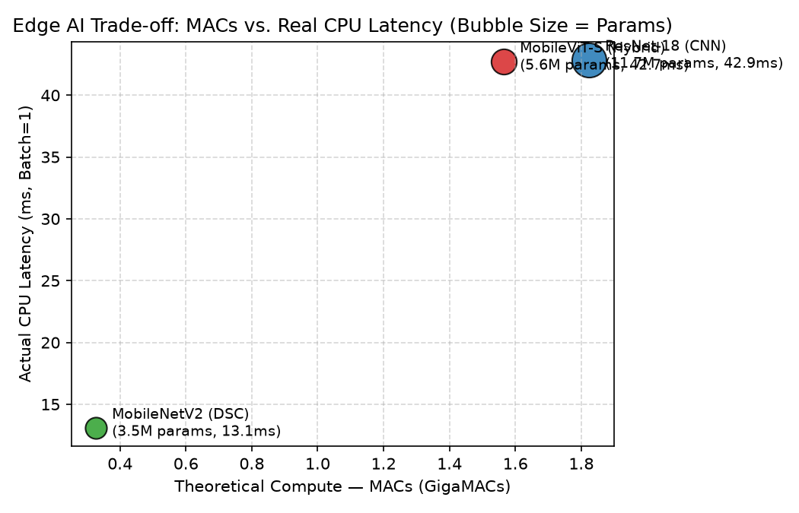
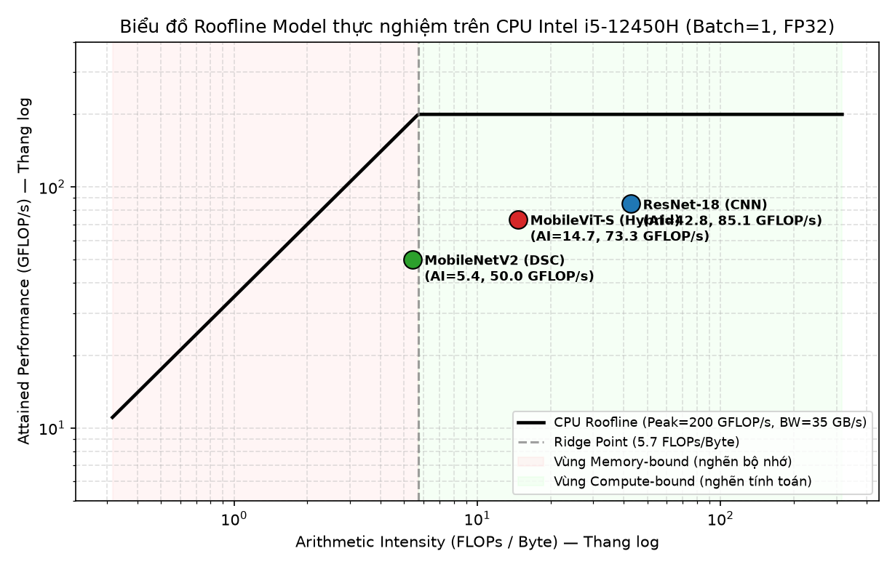
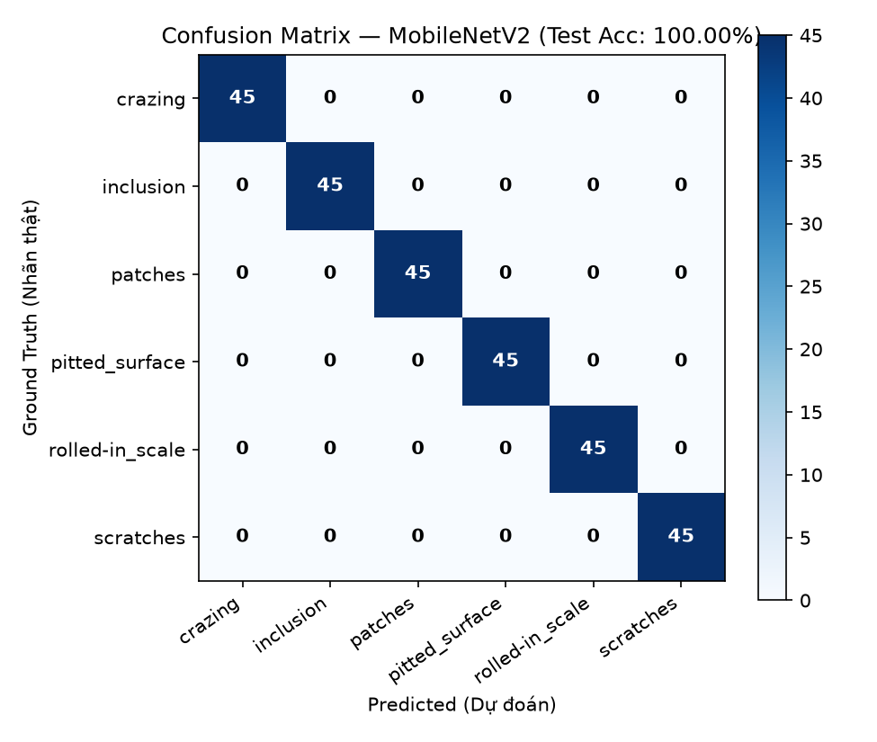
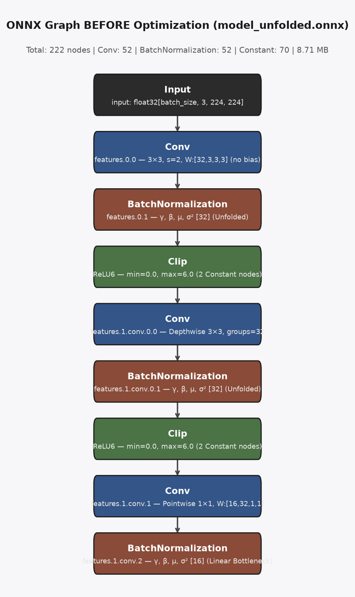
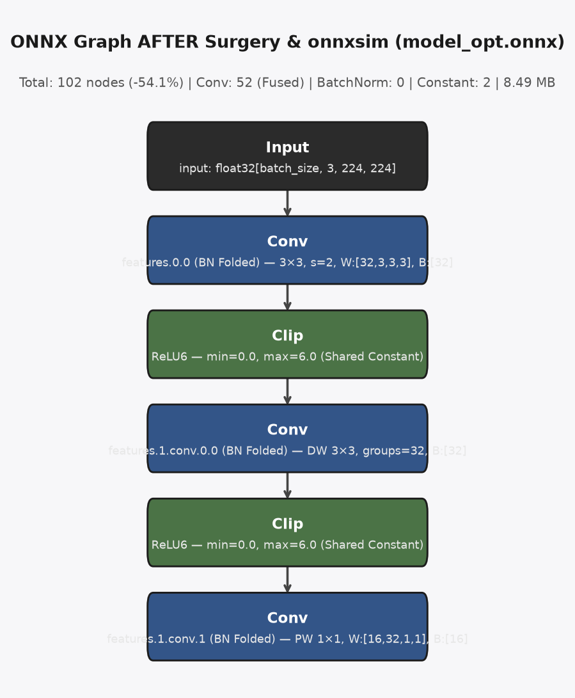
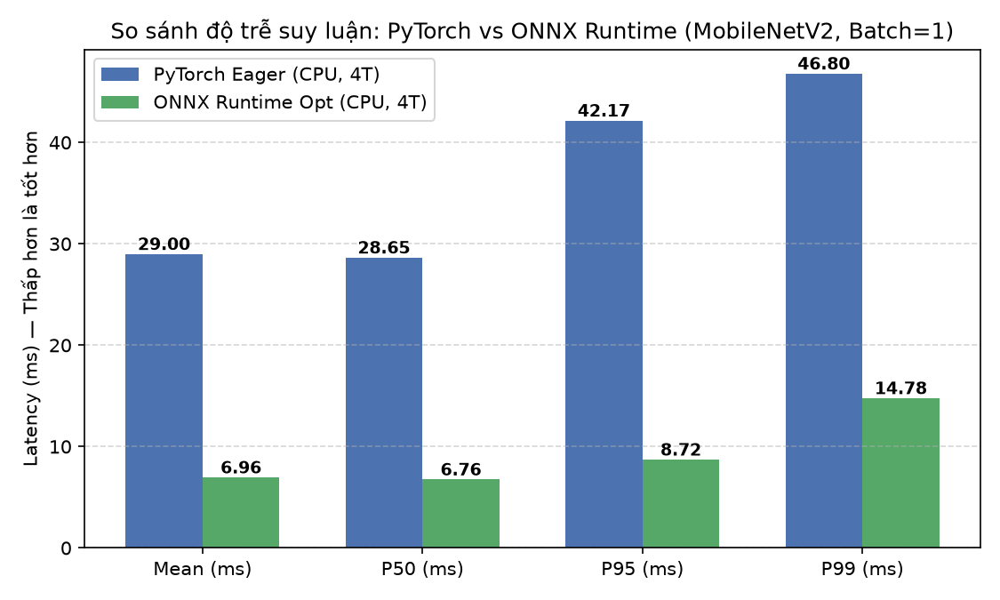

# Từ 37 FPS lên 245 FPS trên CPU: Phân tích Roofline và phẫu thuật đồ thị ONNX cho hệ thống kiểm tra khuyết tật bề mặt thép

Trong các dự án học thuật, câu chuyện thường kết thúc ngay khi mô hình đạt độ chính xác cao trên tập kiểm thử. Nhưng khi bước vào môi trường nhà máy — cụ thể là hệ thống **kiểm tra ngoại quan tự động (Industrial AOI - Automated Optical Inspection)** trên dây chuyền cán thép — độ chính xác cao mới chỉ là điều kiện cần.

Thực tế sản xuất đặt ra một bài toán khắt khe hơn nhiều: camera công nghiệp chụp liên tục từng tấm thép ở kích thước batch bằng 1 (`batch_size = 1`), nhiều trạm biên không trang bị GPU rời mà chỉ chạy trên máy tính công nghiệp (IPC) dùng CPU đa nhân. Làm sao để mô hình vừa đạt độ chính xác gần như tuyệt đối (không bỏ lọt sản phẩm lỗi), vừa suy luận dưới 5–10 ms mỗi khung hình ngay trên CPU?

Bài viết này chia sẻ toàn bộ quá trình mình thiết kế, thực nghiệm và tối ưu hóa hệ thống **phân loại 6 loại khuyết tật bề mặt thép (NEU Surface Defect)** — từ việc đo đạc phần cứng theo mô hình **Roofline**, đối chiếu thực nghiệm trên **3 kiến trúc mạng (`ResNet-18`, `MobileNetV2`, `MobileViT-S`)**, đến **phẫu thuật đồ thị tính toán ONNX** giúp tăng tốc **5.64 lần** trên CPU Intel Core i5-12450H.

---

## 1. Dự án này đã xây dựng và kiểm chứng được những gì?

Thay vì dừng lại ở một notebook thử nghiệm rời rạc, toàn bộ dự án được tổ chức như một quy trình triển khai chuẩn kỹ sư AI gồm 5 cột mốc:

1. **Đánh giá phần cứng biên thực tế (Hardware-aware Benchmarking):** Đo trực tiếp số tham số (Params), lượng tính toán (MACs), mức tiêu thụ RAM đỉnh (`torch.profiler`), lưu lượng truy xuất bộ nhớ và vẽ biểu đồ **Roofline Model** trên CPU cho 3 trường phái kiến trúc: CNN truyền thống (`ResNet-18`), CNN gọn nhẹ (`MobileNetV2`) và Hybrid CNN-Transformer (`MobileViT-S`).
2. **Quy trình huấn luyện chống rò rỉ dữ liệu (Zero Data Leakage):** Gom toàn bộ 1.800 ảnh của bộ NEU Surface Defect (6 lớp lỗi × 300 ảnh/lớp) và chia phân tầng cố định (`Stratified Split 70% Train / 15% Val / 15% Test`, `seed=42`). Tập Test (270 ảnh) bị khóa hoàn toàn trong suốt quá trình huấn luyện để đánh giá khách quan và làm chuẩn kiểm định cho cả 3 mô hình.
3. **Phẫu thuật đồ thị tính toán ONNX (Graph Surgery):** Tự lập trình công thức **BatchNorm Folding** bằng NumPy thuần để kiểm chứng toán học, sau đó kết hợp với `onnx-simplifier` (`onnxsim`) để xóa sổ toàn bộ 52 node `BatchNormalization` và 68 node `Constant` dư thừa, thu gọn đồ thị từ **222 xuống còn 102 node (-54.1%)**.
4. **Kiểm định sai số dấu phẩy động nghiêm ngặt (`FP32`):** Chạy song song PyTorch gốc và ONNX Runtime trên toàn bộ 270 ảnh tập Test, chứng minh sai số xác suất Softmax cực đại chỉ `2.21e-06` (`< 1e-5`) và tỷ lệ đồng thuận dự đoán Top-1 đạt **100.00%**.
5. **Đo hiệu năng chuẩn sản xuất & Đóng gói mã nguồn CLI:** Benchmark với 50 vòng warm-up + 500 vòng đo thực tế, khóa luồng CPU (`1 thread` và `4 threads`), thống kê phân vị **Mean, P50, P95, P99 Latency**, và đóng gói thành 6 module dòng lệnh độc lập trong `src/` (`dataset.py`, `train.py`, `graph_surgery.py`, `validate.py`, `benchmark.py`, `infer.py`).

---

## 2. Nghịch lý FLOPs vs. Latency dưới góc nhìn mô hình Roofline

Sai lầm phổ biến nhất khi chọn mô hình cho thiết bị biên là chỉ nhìn vào số lượng tham số (**Params**) hoặc số phép nhân-cộng lý thuyết (**FLOPs/MACs**) rồi mặc định mô hình nào nhẹ hơn sẽ chạy nhanh hơn.

Để kiểm chứng, mình đo song song 3 kiến trúc đại diện trên CPU **Intel Core i5-12450H** (`batch_size = 1`, `FP32`, đầu vào `1 × 3 × 224 × 224`):

| Mô hình | Kiến trúc | Params (M) | MACs (G) | Peak RAM (MB) | Lưu lượng RAM ước tính (MB) | Arithmetic Intensity (FLOPs/Byte) | Hiệu năng đạt được (GFLOP/s) |
| :--- | :--- | :---: | :---: | :---: | :---: | :---: | :---: |
| **ResNet-18** | CNN truyền thống | 11.69 | 1.824 | **18.99** | 81.3 | **42.77** | **85.12** |
| **MobileNetV2** | CNN gọn nhẹ | **3.50** | **0.327** | 47.86 | 115.6 | 5.40 | 50.03 |
| **MobileViT-S** | Hybrid Transformer | 5.58 | 1.566 | 88.10 | 203.0 | 14.71 | 73.31 |





Từ đồ thị **Roofline Model**, ta rút ra 3 phát hiện cực kỳ quan trọng giải thích hành vi thực tế của phần cứng:

1. **Nghịch lý `MobileViT-S` so với `ResNet-18`:** Dù `MobileViT-S` có ít tham số hơn một nửa (`5.58M` so với `11.69M`) và ít MACs hơn (`1.566G` so với `1.824G`), độ trễ thực tế trên CPU lại tương đương hoặc chậm hơn nhiều so với `ResNet-18`, đồng thời ngốn **Peak RAM gấp 4.6 lần** (`88.10 MB` so với `18.99 MB`). Nguyên nhân là các phép biến đổi `Unfold/Fold`, `Permute` và `Multi-Head Self-Attention` phát sinh tới `203.0 MB` lưu lượng đọc/ghi bộ nhớ trung gian.
2. **Tại sao `MobileNetV2` ngốn Peak RAM cao hơn `ResNet-18`?** Dù ít tham số hơn 3.3 lần, `MobileNetV2` có `Peak RAM = 47.86 MB` (so với `18.99 MB` của `ResNet-18`) vì cấu trúc mở rộng kênh (`expand_ratio = 6`) ở các tầng đầu có độ phân giải không gian lớn ($112 \times 112$, $56 \times 56$) tạo ra các tensor kích hoạt trung gian rất lớn trong bộ nhớ.
3. **Bản chất Memory-bound chỉ đường cho bước tối ưu hóa:** `ResNet-18` có cường độ tính toán cao (`42.77 FLOPs/Byte`), tận dụng tốt phép nhân ma trận dày đặc trên CPU (`Compute-bound`). Ngược lại, `MobileNetV2` chỉ đạt `5.40 FLOPs/Byte` — nằm sâu trong vùng **Memory-bound** (hiệu năng bị giới hạn bởi băng thông đọc/ghi RAM chứ không phải tốc độ tính toán của CPU). Điều này dẫn đến một kết luận mang tính bước ngoặt: **để tăng tốc `MobileNetV2` trên CPU, ta phải tập trung cắt giảm số lần đọc/ghi bộ nhớ trung gian thông qua gộp toán tử (Operator Fusion & BatchNorm Folding).**

---

## 3. Huấn luyện trên NEU Surface Defect và kết quả đối chiếu 3 mô hình

Bộ dữ liệu **NEU Surface Defect** gồm 1.800 ảnh xám kích thước `200×200`, chia đều cho 6 loại khuyết tật bề mặt thép cán nóng: `crazing`, `inclusion`, `patches`, `pitted_surface`, `rolled-in_scale`, và `scratches`.

Trong bài toán kiểm tra ngoại quan nhà máy, bỏ lọt phế phẩm (**False Negative**) gây thiệt hại lớn hơn nhiều so với báo nhầm. Vì vậy, ngoài việc khóa chặt tập Test 270 ảnh (Stratified Split `70/15/15`), mình áp dụng các phép tăng cường dữ liệu bảo toàn hình thái vết lỗi (lật ngang/dọc, xoay nhẹ `±15°`, điều chỉnh độ sáng/tương phản nhẹ, tránh cắt xén làm mất các vết xước ở biên ảnh).

Cả 3 mô hình đều được tinh chỉnh (Transfer Learning từ trọng số pretrained ImageNet) trên cùng một bộ chia dữ liệu (`seed=42`) bằng GPU **NVIDIA GeForce RTX 4050 Laptop** (`AdamW`, `lr=3e-4`, `CosineAnnealingLR`), sau đó xuất sang định dạng **ONNX** và đo tốc độ suy luận thực tế trên **ONNX Runtime CPU (4 luồng, `batch_size = 1`)**:

| Mô hình | Test Accuracy (270 ảnh) | Dung lượng ONNX (MB) | ORT Mean Latency (ms) | ORT P95 Latency (ms) | ORT Throughput (FPS) | So sánh tốc độ |
| :--- | :---: | :---: | :---: | :---: | :---: | :---: |
| **ResNet-18** | 100.00% | 42.64 MB | 15.52 ms | 19.86 ms | 64.4 FPS | 1.00x (Baseline) |
| **MobileNetV2 (Triển khai chính)** | **100.00%** | **8.49 MB** | **4.07 ms** | **5.29 ms** | **245.5 FPS** | **Nhanh hơn 3.81x** |
| **MobileViT-S** | 100.00% | 19.03 MB | 43.94 ms | 57.86 ms | 22.8 FPS | Chậm hơn 2.83x |



**Nhận xét từ bảng đối chiếu 3 mô hình:**
* Cả 3 kiến trúc đều đạt **100.00% Test Accuracy** (không có bất kỳ ca False Negative nào trên 270 ảnh kiểm thử độc lập).
* Khi độ chính xác đã chạm trần, sự chênh lệch về hiệu quả triển khai trở nên cực kỳ rõ rệt: **`MobileNetV2` chỉ nặng 8.49 MB** (nhỏ hơn **5 lần** so với `ResNet-18` và **2.24 lần** so với `MobileViT-S`), đồng thời đạt tốc độ **`4.07 ms/ảnh` (245.5 FPS)** — **nhanh gấp 3.8 lần `ResNet-18` và nhanh gấp 10.8 lần `MobileViT-S`** trên cùng CPU.

---

## 4. Phẫu thuật đồ thị ONNX: Xóa sổ 54.1% số node tính toán

### 4.1. Bản chất toán học của BatchNorm Folding
Trong quá trình huấn luyện, lớp `BatchNorm2d` tính trung bình và phương sai động theo từng mini-batch. Nhưng khi chuyển sang chế độ suy luận (`eval()`), toàn bộ 4 tham số $(\gamma, \beta, \mu, \sigma^2)$ đã trở thành hằng số tĩnh. Khi một lớp `BatchNorm2d` đứng ngay sau `Conv2d`, ta có thể gộp trực tiếp phép biến đổi tuyến tính này vào trọng số $(W, b)$ của lớp tích chập:

$$W_{\text{fold}} = \frac{\gamma}{\sqrt{\sigma^2 + \epsilon}} \cdot W, \qquad b_{\text{fold}} = \frac{\gamma}{\sqrt{\sigma^2 + \epsilon}} \cdot (b - \mu) + \beta$$

Thay vì phải ghi toàn bộ feature map đầu ra của `Conv2d` xuống RAM, rồi đọc ngược lên để chạy `BatchNorm2d` và lại ghi xuống RAM, CPU giờ chỉ cần thực thi duy nhất một lớp `Conv2d` đã mang sẵn trọng số gập.

Để chắc chắn hiểu sâu thay vì chỉ gọi hàm có sẵn, mình tự viết đoạn mã bằng NumPy thuần trích xuất cặp lớp `features.0.0 (Conv2d)` và `features.0.1 (BatchNorm2d)` của `MobileNetV2`, gập thủ công rồi so sánh đầu ra với cách chạy tách rời. Sai số tuyệt đối cực đại thu được là **`5.72e-06` đến `1.53e-05`** — khớp hoàn toàn trong giới hạn làm tròn 23-bit mantissa của chuẩn dấu phẩy động `IEEE 754 FP32`.

### 4.2. Gập hằng số (Constant Folding) và thống kê đồ thị trước/sau tối ưu
Một chi tiết thực tế ít người để ý: PyTorch 2.x khi xuất ONNX ở chế độ `eval()` mặc định đã tự động gập `BatchNorm`. Để quan sát trực quan cấu trúc gốc trên Netron trước khi phẫu thuật, ta xuất thêm một bản giữ nguyên node bằng cờ `TrainingMode.PRESERVE` (`model_unfolded.onnx`), sau đó tối ưu toàn diện bằng **`onnx-simplifier` (`onnxsim`)** để ra file cuối cùng `model_opt.onnx`.

Bảng thống kê số lượng từng loại toán tử (`NodeProto.op_type`) đọc trực tiếp từ `GraphProto`:

| Toán tử ONNX | Trước tối ưu (`model_unfolded.onnx`) | Xuất `eval` chuẩn (`model_raw.onnx`) | Sau `onnxsim` (`model_opt.onnx`) | Tác động kỹ thuật |
| :--- | :---: | :---: | :---: | :--- |
| **`BatchNormalization`** | **52** | **0** | **0** | Gập hoàn toàn 52 lớp BN vào trọng số & bias của 52 lớp `Conv` |
| **`Constant`** | **70** | **70** | **2** | `onnxsim` loại bỏ 68 node hằng số ngưỡng `Clip(0, 6)` trùng lặp |
| **`Conv`** | 52 | 52 | 52 | 52 tầng tích chập đã được tích hợp sẵn tham số chuẩn hóa |
| **`Clip` (`ReLU6`)** | 35 | 35 | 35 | 35 lớp kích hoạt phi tuyến |
| **`Add`** | 10 | 10 | 10 | 10 nhánh cộng tắt (skip connections) |
| **`GlobalAveragePool` / `Flatten` / `Gemm`** | 1 / 1 / 1 | 1 / 1 / 1 | 1 / 1 / 1 | Khối gộp đặc trưng và lớp phân loại tuyến tính cuối |
| **TỔNG SỐ NODE** | **222** | **170** | **102 (-54.1%)** | **Cắt giảm hơn một nửa số node trên toàn đồ thị** |
| **Dung lượng file** | 8.71 MB | 8.49 MB | **8.49 MB** | Gọn nhẹ hơn sau khi loại bỏ các tensor $\gamma, \beta, \mu, \sigma^2$ |

| Trước phẫu thuật (`model_unfolded.onnx`) | Sau phẫu thuật (`model_opt.onnx`) |
| :---: | :---: |
|  |  |

---

## 5. Kiểm định sai số số học và lý giải cú tăng tốc 5.64x trên CPU

### 5.1. Kiểm định số học trên toàn bộ 270 ảnh tập Test
Bất kỳ bước tối ưu đồ thị nào trong sản xuất đều phải vượt qua bài kiểm tra **Numerical Parity** để đảm bảo việc đổi thứ tự phép toán dấu phẩy động không làm lệch kết quả dự đoán. Chạy suy luận song song giữa PyTorch gốc và `model_opt.onnx` trên ONNX Runtime cho kết quả:

* **Sai số trên Logits:** Cực đại `1.67e-05` | Trung bình `2.40e-06`
* **Sai số trên xác suất Softmax:** Cực đại **`2.21e-06` (`< 1e-5`)** | Trung bình **`3.17e-09`**
* **Độ chính xác trên tập Test:** PyTorch `100.00%` vs. ONNX Runtime `100.00%`
* **Độ đồng thuận dự đoán Top-1:** **`100.00%` (khớp tuyệt đối 270/270 ảnh)**

### 5.2. Benchmark độ trễ chuẩn sản xuất (50 vòng warm-up + 500 vòng đo thực tế)
Để đo độ trễ không bị nhiễu bởi bộ nhớ đệm hay lập lịch hệ điều hành, mình khóa cứng số luồng CPU (`torch.set_num_threads` và `intra_op_num_threads` với chế độ `ORT_SEQUENTIAL`, `ORT_ENABLE_ALL`), thực hiện 50 vòng warm-up và ghi nhận phân phối độ trễ qua 500 vòng lặp ở `batch_size = 1`:

| Engine suy luận | Số luồng CPU | Mean (ms) | P50 (ms) | P95 (ms) | P99 (ms) | Throughput (FPS) | Tăng tốc |
| :--- | :---: | :---: | :---: | :---: | :---: | :---: | :---: |
| PyTorch Eager (CPU) | 1 | 22.07 | 20.05 | 36.11 | 42.29 | 45.3 | 1.00x |
| **ONNX Runtime Opt (CPU)** | **1** | **9.78** | **9.00** | **15.31** | **20.83** | **102.3** | **2.26x** |
| PyTorch Eager (CPU) | 4 | 26.55 | 25.05 | 43.90 | 61.06 | 37.7 | 1.00x |
| **ONNX Runtime Opt (CPU)** | **4** | **4.71** | **4.35** | **7.07** | **10.40** | **212.5** | **5.64x** |



**Tại sao PyTorch tăng từ 1 luồng lên 4 luồng lại chậm đi (`22.07 ms → 26.55 ms`), trong khi ONNX Runtime lại tăng tốc vọt lên `4.71 ms` (nhanh hơn 5.64x)?**

Đây là điểm thú vị nhất về mặt hệ thống (Systems Engineering) mà mình rút ra được từ thực nghiệm này:
1. **Chi phí điều phối Python và tranh chấp luồng trong PyTorch Eager:** Ở `batch_size = 1`, khối lượng tính toán của từng tầng `MobileNetV2` rất nhỏ. Khi chạy PyTorch Eager, mỗi tầng trong hơn 100 tầng của mạng đều phải đi qua lớp điều phối Python gọi xuống C++, đồng thời bật/tắt đồng bộ 4 luồng OpenMP liên tục (*thread contention*). Chi phí đồng bộ hóa này còn lớn hơn cả lợi ích song song hóa, khiến chạy 4 luồng chậm hơn chạy 1 luồng.
2. **Thực thi đồ thị tĩnh C++ và hợp nhất kernel trong ONNX Runtime:** ONNX Runtime chỉ tốn đúng 1 lần gọi từ Python xuống C++ cho toàn bộ 102 node. Với mức tối ưu `ORT_ENABLE_ALL`, engine tiếp tục tự động hợp nhất cặp `Conv + Clip (ReLU6)` thành một kernel duy nhất (**ConvActivation Fusion**), sắp xếp lại bố cục bộ nhớ theo chiều rộng thanh ghi SIMD AVX2 (`NCHWc`) và chia tải mượt mà trên 4 nhân CPU bằng thư viện **MLAS**. Nhờ đó, ngay cả ở phân vị **P95 (`7.07 ms`)** và **P99 (`10.40 ms`)**, hệ thống vẫn dễ dàng đáp ứng yêu cầu thời gian thực trên dây chuyền công nghiệp tốc độ cao.

---

## 6. Kết luận và mã nguồn dự án

Dự án này cho thấy tối ưu hóa mô hình thị giác máy tính không phải là việc đánh đổi độ chính xác lấy tốc độ một cách mù quáng, mà là sự kết hợp chặt chẽ giữa **hiểu đặc trưng phần cứng (Roofline Model)**, **lựa chọn kiến trúc dựa trên số liệu thực nghiệm đa mô hình**, và **phẫu thuật đồ thị tính toán (BatchNorm Folding + Constant Folding + Static C++ Runtime)**.

Toàn bộ mã nguồn sạch gồm 6 module CLI (`dataset.py`, `train.py`, `graph_surgery.py`, `validate.py`, `benchmark.py`, `infer.py`), 2 notebook phân tích chi tiết và file trọng số tối ưu `model_opt.onnx` (`8.49 MB`) đã được đóng gói hoàn chỉnh trong repository:

```bash
# Chạy thử suy luận thời gian thực trên 1 ảnh bề mặt thép bằng ONNX Runtime
python src/infer.py --image data/NEU-DET/validation/images/scratches/scratches_241.jpg
# Output:
# Prediction : scratches (100.00%)
# Latency    : 4.30 ms (232.6 FPS)
```

*(Dán link GitHub repository của bạn tại đây — Rất mong nhận được góp ý và trao đổi từ cộng đồng Computer Vision & Edge AI!)*
